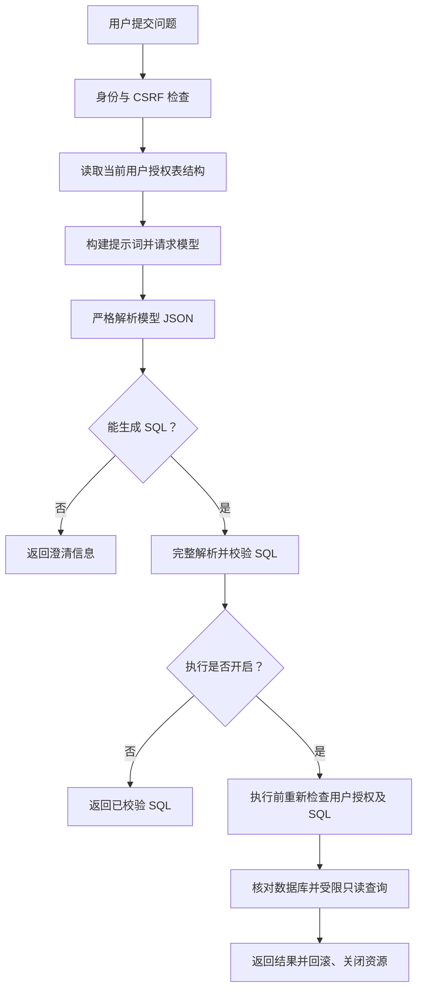

# SQLFINDER

基于 Java 与 Spring Boot 的自然语言问数工具：生成 SQL，经只读与表权限校验后执行，并直观展示查询结果。

**第 1 版：v0.1.0 · 2026-10-11。** 保存首个可运行原型，后续重点是业务正确性、SQL 规则边界及执行限制验证。

## 已实现

- 按全局表白名单与当前账号授权的交集读取结构、构建模型输入。
- 对接 DeepSeek，严格解析模型正文 JSON。
- 使用 JSqlParser 完整解析 SQL，检查单条 SELECT、真实表引用、函数白名单及支持的语法节点。
- 执行前按同一用户再次校验，使用只读事务、超时、返回行数及结果大小限制。
- 提供问数工作台，显示 SQL、校验摘要与结果，支持筛选、分页及 CSV 导出。
- 查询结果可切换柱状图、折线图和饼图，选择维度/数值字段，导出 PNG；类型推荐和绘图均不额外请求模型或数据库。
- 对话首页采用深色侧栏、问题消息、折叠 SQL 和底部输入，支持历史会话、刷新恢复、追问和重新生成。
- 提供 BCrypt 配置账号、Session 登录、CSRF、退出及统一错误响应。
- 提供 DeepSeek 网页设置：连接测试、模型及超时配置、密钥更新/清除，保存后即时生效并在重启后保留。
- 提供 MySQL 网页设置：候选连接检测、物理表选择、字段预览、只读账号脚本；连接与全局表范围在重启时一起启用。
- 使用统一请求 ID 和本地 H2 记录工作流阶段、耗时及失败原因；默认 120 秒总时限，支持停止模型请求及数据库查询。
- 提供启动诊断、Windows 启动和账号初始化脚本、带校验清单的离线备份恢复及实验版打包入口。

默认开启只读查询，校验通过后返回数据库结果。会话、返回结果和简短运行审计由本地 H2 文件保存，支持重启及刷新后恢复、继续追问和重新生成。当前版本用于实验与原型验证；字段/行权限、自动纠错和全面的模型正确率评估可按实际反馈继续完善。

## 工作流



提示词帮助模型生成查询；能否执行由服务端校验和数据库权限决定。候选 SQL 自带的摘要不作为授权依据。

## 启动

Windows 实验包解压后，按包内 `START-HERE.txt` 初始化登录账号、配置 MySQL 与 DeepSeek，再运行 `scripts/start.ps1`。运行包需要 JDK 17 或以上，不需要 Maven 或 Node.js；备份前停止服务，使用 `scripts/backup.ps1 -BackupPath ...`，恢复至空安装目录使用 `scripts/restore.ps1 -BackupPath ...`。发布包仅包含公开模板与样例，不包含本机真实凭据和会话记录。

需要 JDK 17 或以上、Maven、MySQL 和模型 API key。先用 `mvn -version` 核对 Maven 使用的 JDK。

在仓库根目录，将 [配置示例](src/main/resources/application-local.example.yml) 复制为同目录的 `application-local.yml`，填写本机数据库和模型配置，或设置 `SQLFINDER_DB_URL`、`SQLFINDER_DB_USERNAME`、`SQLFINDER_DB_PASSWORD`、`DEEPSEEK_API_KEY`。本机配置由 Git 忽略，不要提交真实凭据。

默认配置使用 `mybatis.tb_shop` 与 `mybatis.tb_shop_type`，仓库不包含这两张商铺表的数据。另提供 [Sakila 样例脚本](samples/sakila)，可导入独立的 `sqlfinder_sakila` 库，练习电影租赁、收入统计和多表关联；导入步骤、参考问题和验收结果见 [项目手册](../docs/PROJECT-HANDBOOK.md#sakila-sample)。使用自己的数据库时，修改 `sqlfinder.metadata.catalog` 和 `allowed-tables`，或通过网页数据库设置保存连接与选表。数据库连接账号应只具备必要业务表的 SELECT 权限。

```powershell
mvn -DskipTests package
# 仅首次初始化登录账号时运行；密码在本机终端隐藏输入。
& "$env:JAVA_HOME/bin/java.exe" -jar target/sqlfinder-server-0.1.0.jar --configure-login
```

初始化后，在生成的 `config/auth.properties` 中添加主账号的明确表授权，例如：

```properties
sqlfinder.auth.users[0].allowed-tables[0]=mybatis.tb_shop
sqlfinder.auth.users[0].allowed-tables[1]=mybatis.tb_shop_type
```

没有表授权的账号可以登录，但不能问数。修改配置后需要重启；当前没有权限热更新。

```powershell
mvn spring-boot:run
```

打开 [问数工作台](http://localhost:8081/)。IDEA 启动时将工作目录设为仓库根目录，以便读取 `config/auth.properties`。

默认执行已校验的只读查询，无需额外启用。数据库账号只应授予授权业务表的 `SELECT`；应用不执行数据或表结构写操作。查询超时默认 5 秒，最多返回 1000 行。如需调试生成 SQL，可在启动服务的终端设置 `$env:SQLFINDER_QUERY_ENABLED='false'` 切换到仅校验模式；移除该覆盖后恢复默认查询。

## 主要接口

| 接口 | 用途 |
| --- | --- |
| GET /health | 匿名健康检查 |
| GET /api/system/diagnostics | 当前账号的配置、只读数据库与本地历史诊断 |
| GET /api/chat/requests/{id} | 当前账号的运行阶段与审计 |
| POST /api/chat/requests/{id}/cancel | 停止当前账号请求，需要 CSRF |
| GET /api/auth/csrf | 获取当前 CSRF token 和 headerName |
| POST /api/auth/login | 表单登录，需要 CSRF |
| GET /api/auth/me | 当前登录用户 |
| POST /api/auth/logout | 退出，需要 CSRF |
| GET /api/datasource/schema | 当前用户授权结构，local-metadata profile 下启用 |
| GET /api/chat/sql-policy | 当前 SQL 策略与执行配置 |
| POST /api/chat/question | 提交 JSON question，需要登录及 CSRF |

工作台自动处理 Cookie 和 CSRF。模型调用、结构读取或格式解析失败返回统一 HTTP 错误；SQL 拒绝、澄清和查询结果通过业务状态区分。

## 网页模型设置

登录后点击工作台的“设置”，或打开 [设置页](http://localhost:8081/settings.html)。填入 API key、账号支持的模型名称和超时（5～90 秒）。连接测试读取官方 `/models` 并核对所选模型，不生成回答也不保存配置；不能据此保证余额或业务答案正确。“保存并启用”更新下一次模型请求，正在执行的请求继续使用原配置。

新建登录账号时，初始化程序为该本机账号授予设置权限。已有账号需在 `config/auth.properties` 增加以下配置，并重启、重新登录：

```properties
sqlfinder.auth.users[0].settings-admin=true
```

普通账号默认没有设置权限，所有写请求仍须 CSRF。该权限不会自动增加业务表授权。

网页配置保存到服务工作目录下的 `config/runtime.properties`，优先于 YAML/环境变量，重启后继续使用。密钥在该本机文件中以明文保存，应使用私有目录；它及保存临时文件均被 Git 忽略。接口只返回“密钥是否已配置”。输入留空保留原密钥，明确勾选清除才删除；保存成功或离开页面清空输入，不写入浏览器存储。当前仅接受 DeepSeek 官方地址，不跟随 HTTP 重定向。

| 接口 | 权限及用途 |
| --- | --- |
| GET /api/settings/access | 已登录；是否可以管理设置 |
| GET /api/settings/model | 设置管理员；读取脱敏配置 |
| POST /api/settings/model/test | 设置管理员 + CSRF；测试候选配置 |
| POST /api/settings/model | 设置管理员 + CSRF；原子保存并启用 |

## 网页数据库设置与只读账号

设置页的“数据库与权限”可以检查当前业务连接：真实数据库账号、连接库是否匹配、业务表能否读取，以及当前登录账号的应用表授权。只执行固定诊断语句和 LIMIT 0 的表读取检查，不返回业务行。检查直接授权仅包含读取权限时显示对应提示；额外权限、角色或无法确认的权限另行提示。

选择业务表、填写新账号名称和来源主机，可以生成 CREATE USER / GRANT SELECT / SHOW GRANTS 脚本并复制。脚本不会自动执行，也不接收管理员密码；执行前替换密码占位符。已有账号应核对原有权限，脚本不会静默忽略创建失败。

填写 MySQL 主机、端口、库名、只读账号和密码，点击“测试连接并读取表”，再勾选业务表、预览字段、保存。支持普通主机名/IPv4 和规范库表名，暂不支持 IPv6、任意 JDBC 参数或视图；发现前 200 张物理表，最多选择 50 张，每表最多 200 字段。候选测试使用独立连接，不改变当前问数连接。

保存会重新检查候选连接及每张选中表的读取权限。只有直接授权被确认仅包含读取权限的账号才能保存；额外权限或角色未知时先核对授权。页面分别显示“正在使用”和“待重启生效”，保存不切换正在运行的连接池。重启服务后，连接与全局表范围一起加载；原有登录账号的授权不会自动扩大，仍需在 `config/auth.properties` 为每个账号设置 `数据库名.表名` 格式的 allowed-tables。没有交集的账号不能问数。

密码留空只保留同一主机、端口、库名及账号的密码；换目标或账号需重填，无密码账号需明确勾选使用空密码。密码不回显、不写浏览器存储，保存成功、权限失效和离开页面清空输入。连接保存到工作目录 `config/database.properties`，包含明文密码；该文件及 `.database-*.tmp` 均被 Git 忽略，目录应只允许受信任用户访问。原子替换失败保留旧配置。

重启时，已保存数据库配置优先于 YAML、环境变量和命令行，同时覆盖连接、Hikari 目标库和全局表范围；损坏文件会阻止启动，不悄悄回退。要恢复启动配置，先妥善备份并移走该文件。网页仅提供受限 MySQL 连接参数，连接/网络等待设置为 5 秒；表扫描检查 15 秒预算，不保证严格的整个请求时间上限。TLS 可选，启用后验证证书和主机名。

GET /api/settings/database 读取活动范围及脱敏连接状态；POST /api/settings/database/test 检测候选或预览选中表；POST /api/settings/database 保存待重启配置；POST /check 诊断当前连接；POST /grants 生成脚本。均需设置管理员，POST 还需 CSRF，响应禁止缓存。

## 查询结果与图表

查询成功后，结果区默认显示表格，点击“使用推荐”或选择柱状图、折线图、饼图；可手动更换维度和数值字段。图表使用全部已返回数据，不受表格筛选和分页影响。超过 15 行时提供缩放滑块，PNG 导出当前图表视窗，并包含返回行数、截断或饼图分母范围提示；CSV 始终导出全部已返回行。

结果新增 `columnMetadata`：字段名、数据库类型、类别、可空性、精度、小数位及值编码，来自实际 JDBC 结果，空结果也保留。`columns` 和 `rows` 结构不变，但 DECIMAL 和 BigInteger 改为精确字符串，超出 JavaScript 安全整数范围的 Long 也改为字符串；接口使用者应按元数据处理这些值。安全整数和有限浮点数仍为 JSON 数字，日期/时间为字符串，Timestamp 使用不附加时区的 ISO 本地时间，二进制使用 Base64。表格和 CSV 保留返回原值；电子表格软件自行打开 CSV 时可能自动转换类型，精确数值请按文本导入。

图表只接受真实列名和固定的三种图表类型，不执行模型生成的代码。柱状图最多 100 行，折线图最多 1,000 行，饼图最多 12 行；超限要求调整 SQL，不自动截取或合并。重复分类要求明确 SQL 聚合；维度 NULL 不丢弃，全 NULL 数值不能绘图；柱形留空、折线断点保留缺失值。折线横轴支持数值或规范日期/月/时间，按轴值排序而不修改原始表格；时间精度超过毫秒拒绝绘图，无时区日期按原值，带时区时间按 UTC 对齐。

图表数值不超过 ±9,007,199,254,740,991，非整数小数最多 15 位有效数字；转换会损失精度时保留表格和 CSV。轴刻度为近似显示，悬浮提示保留返回原值。饼图拒绝截断、未知完整性、NULL、负值和全零；即使未截断，占比也只相对于本次查询返回数据，不能推断为整个数据库的占比。

图表组件为本地打包的 Apache ECharts **5.6.0**，运行无需 Node.js 或外部 CDN。官方 npm 包经 SHA-512 完整性校验后提取；原始 LICENSE / NOTICE 保留在 `src/main/resources/static/vendor`。组件加载或绘图失败时可继续使用表格与 CSV。

## 第 2 版改进清单

2026-10-11 开始，按以下顺序推进；详细设计与验证记录统一保存在本地项目手册。

- [x] 网页 DeepSeek 配置：管理员权限、连接测试、密钥保护、保存及即时生效。
- [x] Codex 风格对话界面：侧栏、消息、底部输入、当前页面记录切换、SQL 折叠及处理状态。
- [x] 数据库向导首步：当前连接诊断、两层表权限提示、选表和生成只读授权 SQL。
- [x] 数据库连接编辑、保存、结构预览与一致启用（重启时加载，不做连接池热切换）。
- [x] 服务端会话上下文首步：`new_chat`、`resource`、`regenerated` 分别支持新对话、继续追问和重新生成；上下文按用户隔离，最多保留 5 轮摘要并在 schema 变化或 30 分钟不活动后失效。H2 保存会话和结果快照，页面连续展示各轮回答；30 分钟只限制追问，不删除历史，历史按用户、数据源及授权结构隔离。
- [x] 表格/柱状图/饼图/折线图、字段选择、PNG 导出及结果类型、精度、日期、NULL 和截断处理。
- [ ] 有限纠错和取消：每次生成全量校验，限制次数、时间与成本。
- [ ] 业务词汇、指标口径、关系和问题/参考 SQL 对照集。
- [ ] 单次请求总时限与真正取消、最小审计、样例数据库和首次启动诊断；项目无需考虑并发。

不扩展复杂的注册或账号管理功能。图表先使用真实查询结果进行规则推荐及手动选择，不执行模型生成的脚本。

## 本地历史

应用自动创建工作目录下的 `data/history.mv.db`，无需安装 H2、创建数据库账号或手动建表。可通过 `SQLFINDER_HISTORY_PATH` 指定路径前缀，例如 `D:/SQLFINDER-data/history`（不带 `.mv.db`）。H2 依赖随 JAR 打包；没有额外数据库服务，未启用 TCP 服务或网页数据库控制台。它的私有连接池不替换只读 MySQL 业务连接。

历史保存问题、SQL、校验摘要、状态、列元数据、已返回的结果行、截断标记和分支关系，不保存模型密钥或连接密码。浏览器刷新后恢复最新会话的回答及结果，查看历史不调用模型或重放 SQL；旧回答直接展示表格预览，可打开完整已返回结果、图表及 CSV。历史结果是查询当时的快照，重新生成才会重新调用模型、校验并执行。只保存实际返回的数据，截断查询仍保持截断标记；发送给模型的上下文继续仅包含摘要，不包含结果行。旧版仅保存摘要的记录会保留并提示结果未保存；已有文件自动升级为结构版本 2。未完成模型请求或格式解析失败的 HTTP 错误仍未纳入历史，本功能不是完整审计。

历史目录包含业务问题、SQL 和查询结果，应使用私有目录，已被 Git 忽略。备份时先停止应用，再复制整个数据目录；恢复到相同路径即可。不要让多个应用进程同时使用同一文件，不要直接复制正在写入的文件。历史暂不自动删除；30 分钟规则只限制上下文，当前授权或数据源变化会隐藏不匹配的历史。

`GET /api/chat/conversations?offset=0` 读取会话列表，`GET /api/chat/conversations/{id}?offset=0` 读取最近轮次；每页 50 条，返回 `hasMore` 和 `nextOffset`。接口要求登录，重新读取授权，响应禁止缓存。存储读写失败返回 `HISTORY_UNAVAILABLE`，不悄悄改用内存；若查询已执行但保存失败，客户端也不会自动重放查询。

## 验证

2026-10-12：**504 项 Java 默认测试、167 项前端测试通过（119 项真实浏览器 + 48 项图表数据规则）**，Maven clean verify 构建成功。默认验证不调用真实模型或业务数据库。会话上下文与页面交互验证继续保留；新增默认只读查询、显式关闭、默认 HTTP 数据返回及写语句执行前拒绝验证；HTTP 传输测试仅连接本机 stub。数据库向导的绑定、保存、权限及启动拒绝验收记录继续保留。

```powershell
mvn clean verify
```

前端运行不需要 Node.js；浏览器测试需要 Node.js 20 或以上。Windows 默认使用本机 Edge，其他环境可安装 Playwright Chromium。

```powershell
npm install
npm run test:frontend
```

`src/test/java` 中的 `RealQueryIT`、`RealBusinessQueryIT` 和 `RealQueryExecutionIT` 为显式启用的真实验收，不在默认测试范围内。其中前两类调用真实模型；执行前需核对连接账号、样例数据和费用。本轮发布未重复调用真实模型。

此前样例总数、分类统计、筛选和两表关联已完成真实查询对照，JDBC 截断、空结果、错误回滚、超时取消和连接池恢复也已验收；这些证据不代表任意业务问题都能正确回答。
