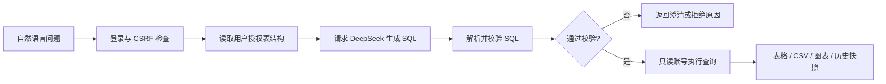

<div align="center">

# SQLFINDER

### 面向受控数据访问的自然语言问数工具

<p>
  <a href="https://github.com/abigmelon/SQLFINDER"></a>
  <a href="https://github.com/abigmelon/SQLFINDER/releases"></a>
  
  
</p>

<p>用自然语言提问，让模型生成 SQL；由服务端完成权限校验和只读执行，再以表格、CSV 或图表返回结果。</p>

</div>

## 为什么选择 SQLFINDER

- **安全可控**：只读取已授权表结构，SQL 经过语法、表引用和函数白名单校验，执行阶段再次核对权限，并使用只读数据库账号。
- **上手直接**：Java + Spring Boot 单体应用，支持 Windows 启动脚本；页面同源提供登录、问数、设置和诊断能力。
- **结果可读**：支持表格筛选、分页、CSV 导出，以及柱状图、折线图和饼图；历史会话和结果快照可在刷新或重启后恢复。
- **便于排查**：统一请求 ID、阶段审计、启动诊断和 Sakila 样例，方便从本地验证逐步接入真实数据库。

## 工作流



模型只负责理解问题和生成候选 SQL；是否允许执行由服务端规则、用户授权和数据库权限共同决定。

## 快速开始

### 环境要求

- JDK 17 或更高版本
- Maven 3.9+
- 可访问的 MySQL 数据库和仅具备业务表 `SELECT` 权限的账号
- DeepSeek API Key

### 从源码启动

在仓库根目录执行：

```powershell
# 复制配置模板并填写本机数据库与模型配置
Copy-Item config-templates/application-local.example.yml src/main/resources/application-local.yml

mvn -DskipTests package

# 仅首次运行：初始化本机登录账号（密码不会写入 Git）
java -jar target/sqlfinder-server-0.1.0.jar --configure-login

mvn spring-boot:run
```

打开 [问数工作台](http://localhost:8081/)。首次初始化后，还需在生成的 `config/auth.properties` 为账号设置 `allowed-tables`；没有表授权的账号可以登录，但不能执行问数。

配置模板也支持以下环境变量：

```text
SQLFINDER_DB_URL
SQLFINDER_DB_USERNAME
SQLFINDER_DB_PASSWORD
DEEPSEEK_API_KEY
```

### Windows 运行包

无需 Maven 或 Node.js 时，可使用发布包中的 `START-HERE.txt` 和 `scripts/start.ps1`。停止服务后，可用 `scripts/backup.ps1` 与 `scripts/restore.ps1` 备份或恢复本地配置、历史会话和结果快照。

## 功能一览

| 模块 | 能力 |
| --- | --- |
| 问数工作台 | 对话提问、SQL 折叠、结果筛选、分页、CSV 导出、重新生成和连续追问 |
| 安全边界 | Session 登录、BCrypt、CSRF、用户级表授权、SQL AST 校验、只读事务和超时限制 |
| 模型设置 | DeepSeek 模型、API Key、超时配置、连接测试和即时启用 |
| 数据库设置 | 连接测试、物理表选择、字段预览、授权诊断和只读账号脚本生成 |
| 结果分析 | 表格、柱状图、折线图、饼图、PNG 导出，以及精度和 NULL 处理 |
| 本地历史 | H2 保存会话、结果快照和阶段审计，支持刷新与重启后恢复 |

## 样例与验证

仓库提供 [Sakila 样例](samples/sakila)，可以导入独立数据库，练习电影租赁、收入统计和多表关联；建表、数据、只读授权和参考问题都已放在样例目录中。

```powershell
# Java 默认测试
mvn -o test

# 浏览器测试（需要 Node.js 20+）
npm install
npm run test:frontend
```

## 当前边界

SQLFINDER 当前用于实验和原型验证。服务端默认只执行通过校验的只读查询；模型生成的 SQL 仍需结合实际业务数据验证，固定样例通过不代表所有自然语言问题都能得到正确答案。字段级/行级权限、有限自动纠错和更完整的模型正确率评估仍在后续路线中。

## 文档与反馈

- [Sakila 样例](samples/sakila)：建表、数据、只读授权和参考问题
- [源码入口](src)：Spring Boot 服务端、网页工作台和测试
- [Issue](https://github.com/abigmelon/SQLFINDER/issues)：提交问题或功能建议

## License

当前仓库尚未发布独立 License 文件。使用或再分发前，请先联系仓库维护者确认许可范围。
