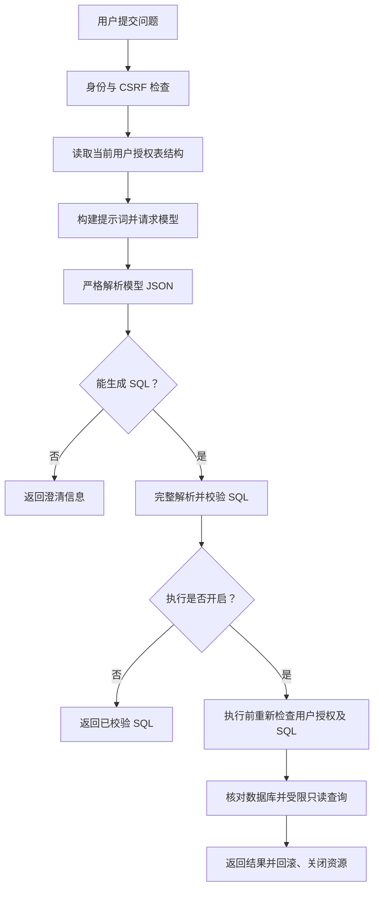

# SQLFINDER

基于 Java 与 Spring Boot 的自然语言问数工具：生成 SQL，经只读与表权限校验后执行，并直观展示查询结果。

**第 1 版：v0.1.0 · 2026-10-11。** 保存首个可运行原型，后续重点是业务正确性、SQL 规则边界及执行限制验证。

## 已实现

- 按全局表白名单与当前账号授权的交集读取结构、构建模型输入。
- 对接 DeepSeek，严格解析模型正文 JSON。
- 使用 JSqlParser 完整解析 SQL，检查单条 SELECT、真实表引用、函数白名单及支持的语法节点。
- 执行前按同一用户再次校验，使用只读事务、超时、返回行数及结果大小限制。
- 提供问数工作台，显示 SQL、校验摘要与结果，支持筛选、分页及 CSV 导出。
- 提供 BCrypt 配置账号、Session 登录、CSRF、退出及统一错误响应。

执行默认关闭。字段/行权限、审计、会话历史和自动纠错尚未实现，当前版本用于学习和原型验证。

## 工作流



提示词帮助模型生成查询；能否执行由服务端校验和数据库权限决定。候选 SQL 自带的摘要不作为授权依据。

## 启动

需要 JDK 17 或以上、Maven、MySQL 和模型 API key。先用 `mvn -version` 核对 Maven 使用的 JDK。

在仓库根目录，将 [配置示例](src/main/resources/application-local.example.yml) 复制为同目录的 `application-local.yml`，填写本机数据库和模型配置，或设置 `SQLFINDER_DB_URL`、`SQLFINDER_DB_USERNAME`、`SQLFINDER_DB_PASSWORD`、`DEEPSEEK_API_KEY`。本机配置由 Git 忽略，不要提交真实凭据。

默认示例使用 `mybatis.tb_shop` 与 `mybatis.tb_shop_type`，仓库不包含业务数据库。使用自己的数据库时，修改 `sqlfinder.metadata.catalog` 和 `allowed-tables`。数据库连接账号应只具备必要业务表的 SELECT 权限。

```powershell
mvn -DskipTests package
# 仅首次初始化登录账号时运行；密码在本机终端隐藏输入。
& "$env:JAVA_HOME/bin/java.exe" -jar target/sqlfinder-server-0.1.0.jar --configure-login
```

初始化后，在生成的 `config/auth.properties` 中添加主账号的明确表授权，例如：

```properties
sqlfinder.auth.users[0].allowed-tables[0]=mybatis.tb_shop
sqlfinder.auth.users[0].allowed-tables[1]=mybatis.tb_shop_type
```

没有表授权的账号可以登录，但不能问数。修改配置后需要重启；当前没有权限热更新。

```powershell
mvn spring-boot:run
```

打开 [问数工作台](http://localhost:8081/)。IDEA 启动时将工作目录设为仓库根目录，以便读取 `config/auth.properties`。

如需执行查询，在启动服务的终端设置 `$env:SQLFINDER_QUERY_ENABLED='true'`。保持默认关闭时，问数只生成并校验 SQL。

## 主要接口

| 接口 | 用途 |
| --- | --- |
| GET /health | 匿名健康检查 |
| GET /api/auth/csrf | 获取当前 CSRF token 和 headerName |
| POST /api/auth/login | 表单登录，需要 CSRF |
| GET /api/auth/me | 当前登录用户 |
| POST /api/auth/logout | 退出，需要 CSRF |
| GET /api/datasource/schema | 当前用户授权结构，local-metadata profile 下启用 |
| GET /api/chat/sql-policy | 当前 SQL 策略与执行配置 |
| POST /api/chat/question | 提交 JSON question，需要登录及 CSRF |

工作台自动处理 Cookie 和 CSRF。模型调用、结构读取或格式解析失败返回统一 HTTP 错误；SQL 拒绝、澄清和查询结果通过业务状态区分。

## 验证

2026-10-11：**328 项 Java 默认测试、48 项浏览器测试通过**。默认测试使用模型、元数据和 JDBC 替身，不调用真实模型或业务数据库。

```powershell
mvn clean verify
```

前端运行不需要 Node.js；浏览器测试需要 Node.js 20 或以上。Windows 默认使用本机 Edge，其他环境可安装 Playwright Chromium。

```powershell
npm install
npm run test:frontend
```

`src/test/java` 中的 `RealQueryIT`、`RealBusinessQueryIT` 和 `RealQueryExecutionIT` 为显式启用的真实验收，不在默认测试范围内。其中前两类调用真实模型；执行前需核对连接账号、样例数据和费用。本轮发布未重复调用真实模型。

此前样例总数、分类统计、筛选和两表关联已完成真实查询对照，JDBC 截断、空结果、错误回滚、超时取消和连接池恢复也已验收；这些证据不代表任意业务问题都能正确回答。
